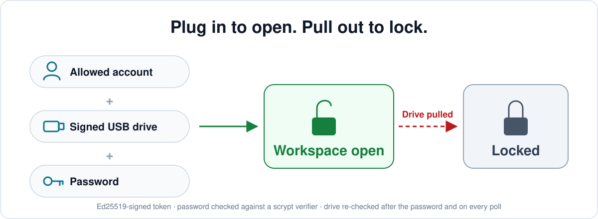

# Tetherlock

**An embeddable Python access-control component, extracted from a larger desktop management system.**

<p align="center">
  <picture>
    <source media="(prefers-color-scheme: dark)" srcset="docs/images/overview-dark.svg">
    
  </picture>
</p>

It provides signed device tokens and a host-driven monitor for opening and closing protected workspaces. The host keeps its own account system, UI and storage. Tetherlock can be studied, adapted and integrated without adopting the original application.

[中文說明](#中文說明) · [Architecture and design decisions](docs/ARCHITECTURE.md) · [Security, fixed defects and limits](SECURITY.md)

> **Portfolio/reference snapshot; no scheduled maintenance.** This is a small reusable component under MIT. The reviewed defects and follow-up fixes are documented (see [SECURITY.md](SECURITY.md)); review it yourself before relying on it to protect real data. There is no promised update schedule or independent security certification.

## Why I extracted it

The original system needed to decide when a protected workspace could open and what should happen when its authorization device disappeared. Keeping those rules inside a main window tied them to one application and made behavior harder to test.

I extracted the mechanism into a UI-independent library with explicit trust and host callbacks. The purpose is to make a focused part of the larger system readable and reusable, rather than publish the entire private system.

## My role and use of AI

I independently defined the original system's design and the boundaries of this extracted component, using AI to help implement, examine alternatives, debug and develop tests. Design decisions and verification approaches were formed through that collaboration, with final scope and tradeoffs owned by me. This is not a claim that every line was written manually or that AI review establishes security assurance.

## How it fits into a host

```text
Offline administrator → signed token on a drive
Host-supplied trust store + account eligibility + password
                              ↓
                   WorkspaceMonitor.poll()
                              ↓
                  on_unlock / on_lock callbacks
                              ↓
                Host UI, file handles and storage
```

Step-by-step diagrams of one check cycle and of the lock lifecycle are in [docs/ARCHITECTURE.md](docs/ARCHITECTURE.md#流程圖).

The intended access sequence checks account eligibility, token signature/expiry/device binding, and the scope password. It rechecks the token and the account after the password prompt, and discards the answer if the host signed out in the meantime. The host schedules polling and implements actual opening and teardown.

| Module | Responsibility and reason for separation |
|---|---|
| [`access.py`](src/tetherlock/access.py) | Signing, verification, password verifiers and explicit trust; usable without a GUI. |
| [`monitor.py`](src/tetherlock/monitor.py) | Polling and workspace lifetime; host callbacks avoid imposing Qt or another toolkit. |
| [`maintenance.py`](src/tetherlock/maintenance.py) | Delegated capabilities and session lifetime; separate from ordinary workspace access. |
| [`plugins.py`](src/tetherlock/plugins.py) | Optional discovery and loading after unlock; the host still owns plugin code trust. |
| [`package.py`](src/tetherlock/package.py) | Optional encrypted hand-over files; separate from authorization of live workspace data. |
| [`cli.py`](src/tetherlock/cli.py) | Offline administration; signing keys need not live on verifying machines. |

## Install and try the CLI

Requires Python 3.10+. Download or clone the repository, open a terminal in its root, and install it:

```text
python -m pip install .
tetherlock --help
```

The following PowerShell example uses a new temporary directory, not real project files or credentials. Each key/password prompt is interactive; use throwaway demo passwords. Signing material stays outside the repository.

```powershell
$tetherDemo = Join-Path ([System.IO.Path]::GetTempPath()) ("tetherlock-demo-" + [guid]::NewGuid().ToString('N'))
New-Item -ItemType Directory -Path $tetherDemo | Out-Null
New-Item -ItemType Directory -Path (Join-Path $tetherDemo 'drive') | Out-Null
tetherlock init-keys --output-dir (Join-Path $tetherDemo 'admin-keys')
tetherlock add-trusted-key --trust-dir (Join-Path $tetherDemo 'trust') --key-id demo --public-key (Join-Path $tetherDemo 'admin-keys/access_public_key.pem')
tetherlock issue-token --private-key (Join-Path $tetherDemo 'admin-keys/access_private_key.pem') --drive-root (Join-Path $tetherDemo 'drive') --allow-copy
tetherlock verify-token --trust-dir (Join-Path $tetherDemo 'trust') --drive-root (Join-Path $tetherDemo 'drive') --check-password
```

Expected result: token verification succeeds after the correct demo workspace password. `--allow-copy` disables device-serial binding for this folder-only experiment; it does not demonstrate physical-device enforcement. Record the temporary path if you want to inspect or remove the demo material later.

### Integrate with an application

This is an integration sketch, not a standalone application. The account and UI functions belong to your host:

```python
from pathlib import Path
from tetherlock import TrustStore, WorkspaceMonitor

trust = TrustStore.from_directory(Path(r"C:\ProgramData\ExampleApp\trust"))
monitor = WorkspaceMonitor(
    trust=trust,
    scopes=["workspace.secure.v1"],
    is_authorized=lambda: current_user.can_open_protected_area,
    prompt_password=ask_password_dialog,
    on_unlock=lambda grant: open_protected_area(grant.vault_root),
    on_lock=lambda scope, handle, reason: handle.close(),
)
# Schedule monitor.poll() on your host timer.
# Call monitor.lock_all() on sign-out/shutdown; it also invalidates an open password prompt.
```

The host must choose a trust directory ordinary users cannot modify, manage polling, close every relevant handle/view, and decide its own account and storage policy. The library cannot enforce those responsibilities on its caller.

## Verification and current limits

On 2026-09-25, after the review fixes, Windows tests with Python 3.10.11 and 3.14.6 and cryptography 50.0.1 each recorded **138 passed, 1 skipped**. The skipped symlink test lacked Windows privileges; an earlier separate check found an existing junction was rejected. A wheel build, installing it into a fresh environment and running the CLI from it passed. These results are not a comprehensive host integration or physical USB test.

On 2026-09-26, the additional revocation, bounded-read and maintenance-clock fixes passed the full suite on Windows with Python 3.10.11 and 3.14.6 / cryptography 50.0.1: **143 passed, 1 skipped** on each. Four new cases fail on the previous version; one additional header case confirms an existing guard. The updated wheel and source distribution build, and importing the wheel and invoking its CLI help, passed.

```text
python -m pip install ".[test]"
python -m pytest
```

AI-assisted review found defects in maintenance-token revalidation and scope, sign-out during a password prompt, malformed token handling and package KDF cost, plus a too-broad dependency floor. All were fixed, each with tests that fail on the old code; see [SECURITY.md](SECURITY.md). Passing tests do not prove that no other defects exist.

The library authorizes access; it does **not encrypt live workspace files**. Device-serial binding is not clone protection, there is no per-token revocation list, and removal is noticed on the next poll. The optional encrypted package format is a different feature.

## Reading guide and license

Start with [`monitor.py`](src/tetherlock/monitor.py) for the host contract, then [`access.py`](src/tetherlock/access.py) and [`tests/test_trust.py`](tests/test_trust.py) for explicit trust. [Architecture](docs/ARCHITECTURE.md) explains the extraction tradeoffs. No private parent-system data is needed to run the library tests. [MIT license](LICENSE).

## 中文說明

**這是從我原本的桌面系統管理專案抽出的 Python 存取控制元件。** 目的不是再提供一套完整管理系統，而是讓別人能閱讀、修改，或把授權裝置與工作區開關的機制接到自己的系統。

產品與整體設計由我獨立負責，實作、判斷和驗證透過我與 AI 協作完成。抽離時把信任來源改成宿主明確傳入，並把帳號判斷、密碼介面、開啟與關閉交給 callback，避免強迫使用者採用原系統的 GUI 與資料模型。

安裝和暫存資料夾示範見上方；嵌入自己的系統還需要提供帳號、介面、輪詢、信任資料夾權限與確實關閉資源的實作。2026-09-25 修正後，Python 3.10／3.14 各有 138 通過、1 跳過的測試紀錄，wheel 建置、安裝到乾淨環境及 CLI 執行驗證通過；沒有宣稱所有宿主或實體 USB 情境都測過。

**AI 輔助審查找到的維護授權重驗、提示途中登出、異常 token、加密包運算成本及相依版本範圍問題已修正，每一項都有在舊程式上會失敗的測試。** 元件不加密工作區原始資料，序號不能防整碟複製，也沒有逐 token 撤銷清單。請先看 [SECURITY.md](SECURITY.md) 再決定如何採用。2026-09-26 又補上關閉回呼失敗時繼續撤銷其他授權、加密包實際讀取上限、維護時鐘失敗清除授權；Python 3.10／3.14 全套各 143 通過、1 跳過，另完成新版 wheel／原始碼套件建置與 wheel CLI 檢查。暫無固定維護計畫，未來是否更新不作承諾；採 MIT 授權，可作設計參考與自行改作。
