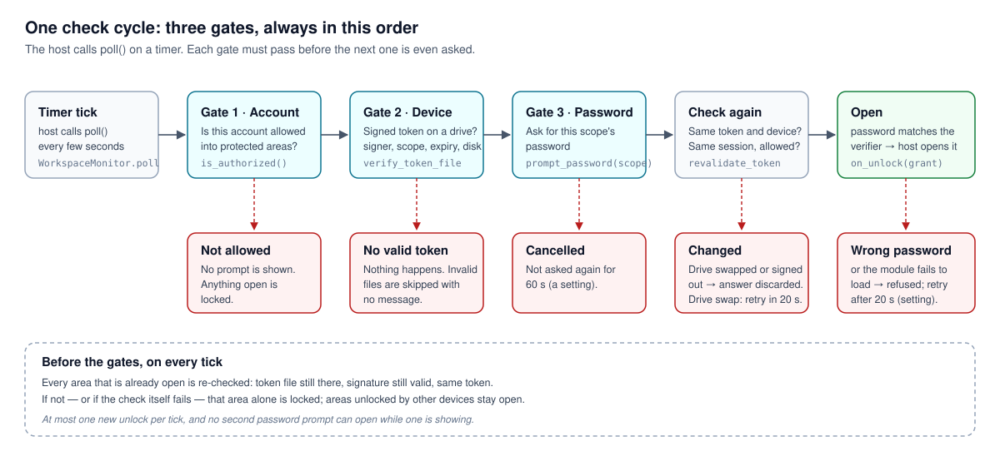
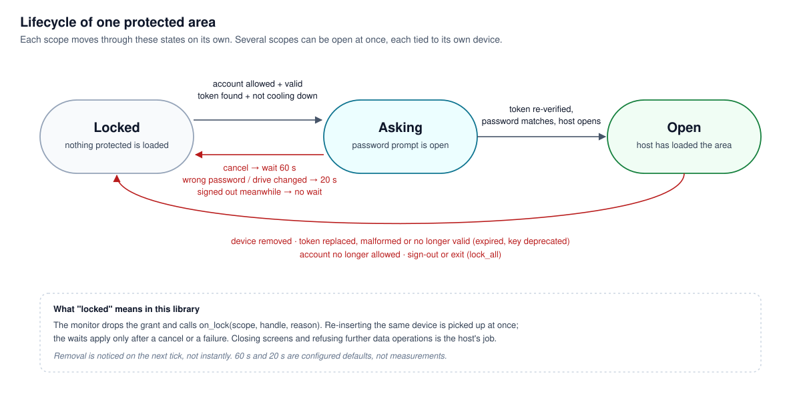

# Tetherlock — 從完整系統抽出可嵌入元件

[README](../README.md) · [安全邊界](../SECURITY.md)

## 設計角色與問題

原本的桌面系統需要把工作區存取與授權裝置連動。作者獨立定義系統及抽離範圍，使用 AI 協作實作、討論取捨和驗證。公開部分保留授權機制，不包含原系統的業務資料、帳號模型或 UI。

## 三個明確邊界

| 邊界 | 這個元件負責 | 宿主或管理者負責 |
|---|---|---|
| 簽發與信任 | token 格式、簽章驗證、TrustStore | 離線保護簽發私鑰、部署公鑰、保護信任目錄權限 |
| 工作區生命週期 | poll 驅動的狀態與 callback | 帳號資格、密碼視窗、排程、真正關閉畫面與檔案 handle |
| 儲存與擴充 | 可選插件載入、可選加密交付包 | 工作區原始資料加密、插件來源、業務權限、備份與復原 |

## 流程圖

**一次檢查的完整流程。** 宿主定時呼叫 `poll()`，三道門依序檢查：帳號資格、隨身碟上的簽章授權、密碼。輸入密碼後會再確認一次授權與登入狀態，任何一步不通過都不會打開。

  <picture>
    <source media="(prefers-color-scheme: dark)" srcset="images/three-gates-dark.svg">
    
  </picture>

**一個工作區的狀態。** 上鎖、詢問密碼、已開啟三種狀態之間怎麼切換；拔除隨身碟、授權失效、帳號失去資格或登出時回到上鎖。

  <picture>
    <source media="(prefers-color-scheme: dark)" srcset="images/lock-lifecycle-dark.svg">
    
  </picture>

圖中的 60 秒、20 秒是預設設定值，不是實測數字；拔除後在下一次輪詢才會上鎖。

## 為什麼這样分

- **`access` 和 `monitor` 分開：** 同一套 token 驗證可由 CLI 或宿主使用；輪詢流程不必包含 GUI。測試可以注入時鐘與 callback，觀察取消、裝置改變及開關順序。
- **信任必須明確傳入：** 抽離前的環境變數公鑰查找會讓信任來源被使用者改寫；現在由宿主傳 `TrustStore`，測試禁止恢復隱含來源。代價是每個宿主必須自己部署和保護信任目錄。
- **維護權限獨立：** 普通工作區與代管能力有不同生命週期及允許清單，避免一個布林值代表所有權限。維護 session 每次使用都重新驗證授權檔，且只接受維護 scope 的授權。
- **CLI 和 library 分開：** 管理者可以在離線機器簽發，驗證端只需公鑰；使用者不必為嵌入元件裝 GUI。
- **可選工具不決定核心：** plugins 與 package 是附加能力。加密交付包不代表即時工作區也有加密，採用者可以只取需要的部分。

## 保持小，而不是為了展示增加框架

現有 `src/tetherlock/` 加 `tests/` 已足夠。`access.py` 同時容納格式、密碼 verifier 與信任處理，是可再拆分的選擇；目前沒有為了分檔而增加抽象層。模組是否值得拆，應由變更範圍和測試負擔決定。

## 閱讀順序與未解問題

1. [`monitor.py`](../src/tetherlock/monitor.py)：宿主如何接進來。
2. [`access.py`](../src/tetherlock/access.py)：如何判斷信任與 token。
3. [`test_monitor.py`](../tests/test_monitor.py)、[`test_trust.py`](../tests/test_trust.py)：已有行為證據。
4. [SECURITY](../SECURITY.md)：外部審查找到並已修正的缺陷，以及刻意保留的限制。

這是可修改的設計作品，不宣稱能阻止惡意宿主、同帳號惡意程式或管理員。無固定更新計畫，重要資料使用前，採用者仍需自行審查並做自己的整合測試。
